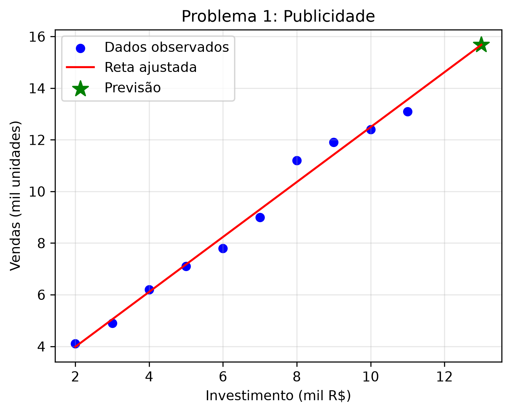
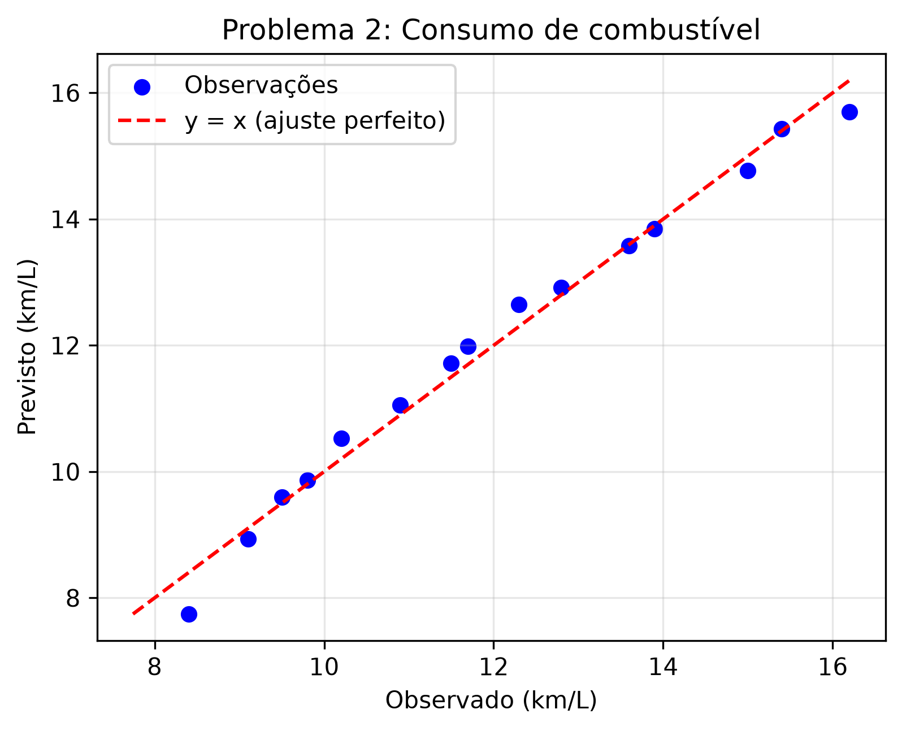
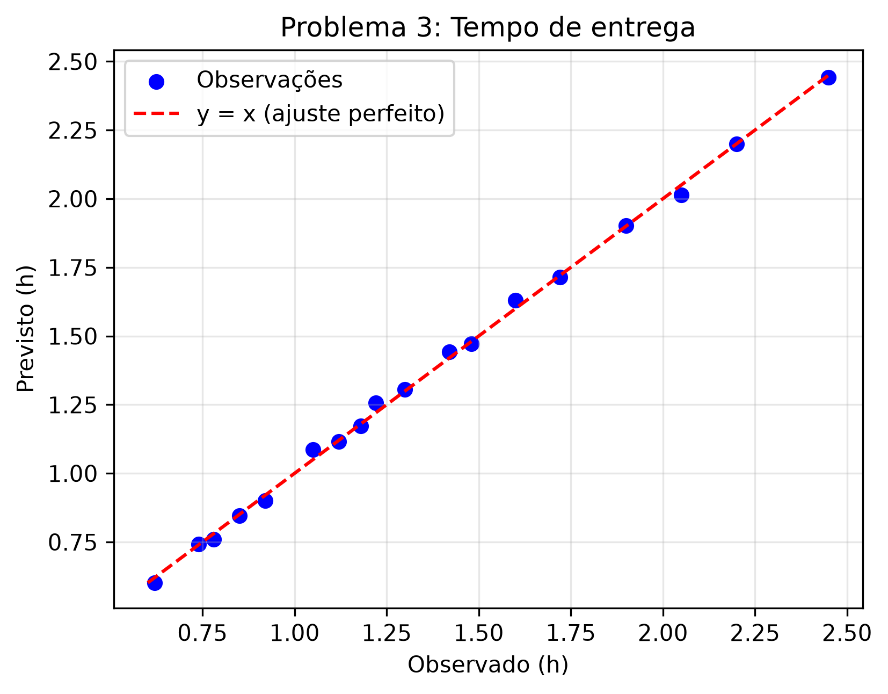

# Regressão Linear Múltipla pelo Método dos Mínimos Quadrados

Projeto de Matemática Aplicada, Cálculo II (UNIVASF), prof. Carlos Antônio Freitas da Silva.
Autor: Ícaro Rafael dos Santos Silva

Implementação do Método dos Mínimos Quadrados (MMQ) para modelos afins com 2 e 4 parâmetros, resolvendo as equações normais e aplicando o modelo a três problemas reais.

## Fundamentação

Para um modelo com três variáveis explicativas $(x, y, z)$ e resposta $w$:

$$f(x, y, z) = \alpha x + \beta y + \gamma z + \delta$$

O MMQ minimiza a soma dos quadrados dos erros:

$$s(\alpha, \beta, \gamma, \delta) = \sum_{i=1}^{m} (\alpha x_i + \beta y_i + \gamma z_i + \delta - w_i)^2$$

Igualando as quatro derivadas parciais a zero, obtém-se o sistema de equações normais:

$$
\begin{bmatrix}
\sum x_i^2 & \sum x_i y_i & \sum x_i z_i & \sum x_i \\
\sum x_i y_i & \sum y_i^2 & \sum y_i z_i & \sum y_i \\
\sum x_i z_i & \sum y_i z_i & \sum z_i^2 & \sum z_i \\
\sum x_i & \sum y_i & \sum z_i & m
\end{bmatrix}
\begin{bmatrix} \alpha \\ \beta \\ \gamma \\ \delta \end{bmatrix} =
\begin{bmatrix} \sum x_i w_i \\ \sum y_i w_i \\ \sum z_i w_i \\ \sum w_i \end{bmatrix}
$$

Em forma matricial geral, com $X \in \mathbb{R}^{m \times n}$ (uma coluna por termo do modelo, a última de 1s):

$$(X^T X)\,c = X^T w$$

## Problemas

| #   | Problema               | Parâmetros | Pergunta                              |
| --- | ---------------------- | :--------: | ------------------------------------- |
| 1   | Publicidade × vendas   |     2      | Vendas para investimento de R$ 13 mil |
| 2   | Consumo de combustível |     4      | Consumo para 1400 kg, 108 cv, 1,8 L   |
| 3   | Tempo de entrega       |     4      | Tempo para 26 km, 8 kg, 5 paradas     |

## Resultados

Valores obtidos com `python main.py` (arredondados na 6ª casa decimal).

### Coeficientes

| Problema | Termo        | Coeficiente |
| -------- | ------------ | ----------: |
| 1        | investimento |    1.063636 |
| 1        | constante    |    1.856364 |
| 2        | peso         |   -0.000101 |
| 2        | potência     |   -0.052387 |
| 2        | cilindrada   |   -1.956822 |
| 2        | constante    |   21.149932 |
| 3        | distância    |    0.028225 |
| 3        | peso         |    0.027345 |
| 3        | paradas      |    0.075052 |
| 3        | constante    |    0.059722 |

### Ajuste e previsões

| Problema |   R²    | R² ajustado |  RMSE   | Nº de condição de A | Previsão    |
| -------- | :-----: | :---------: | :-----: | :-----------------: | :---------- |
| 1        | 0.984526 |  0.982592   | 0.383002 |        319.48       | 15.6836 mil un. |
| 2        | 0.985683 |  0.981779   | 0.280343 |     7,59 × 10⁸      | 11.8281 km/L    |
| 3        | 0.998569 |  0.998263   | 0.019526 |       7.648,10      | 1.3876 h        |

### Gráficos

**Problema 1 — Publicidade**



**Problema 2 — Consumo de combustível**



**Problema 3 — Tempo de entrega**



## Como executar

Requer Python 3.8+.

```bash
git clone https://github.com/ssantos-icaro/regressao_linear_c2.git
cd regressao_linear_c2
pip install -r requirements.txt
python main.py
```

Para cada problema, o programa imprime `A = XᵀX` e `b = Xᵀy`, os coeficientes, as verificações numéricas, a previsão, as métricas (SSE, SST, R², R² ajustado, RMSE, resíduos) e as matrizes em LaTeX. Os gráficos são salvos em `graphics/`.

## Estrutura

```
.
├── main.py             # configuração dos problemas, saída e gráficos
├── mmq.py              # funções do MMQ
├── csv_files/          # dados de entrada (CSV com cabeçalho; resposta na última coluna)
├── graphics/           # gráficos gerados
├── requirements.txt
└── .gitignore
```

### Funções de `mmq.py`

- `carregar_dados`: lê o CSV e valida o formato.
- `montar_X`: acrescenta a coluna de 1s do termo constante.
- `resolver_mmq`: monta e resolve as equações normais.
- `verificar`: simetria de `A`, comparação com `np.linalg.lstsq` e número de condição.
- `prever`: resposta para um novo ponto.
- `metricas`: resíduos, SSE, SST, R², R² ajustado e RMSE.
- `para_latex`: converte matrizes e vetores em `bmatrix`.

## Observações

- **Extrapolação (problema 1):** R$ 13 mil está fora do intervalo dos dados (2 a 11 mil), então a previsão é menos confiável que uma interpolação.
- **Multicolinearidade (problemas 2 e 3):** as variáveis explicativas crescem juntas, o que deixa `XᵀX` mal condicionada e pode gerar coeficientes com sinal contraintuitivo. Por isso o programa imprime o número de condição.
